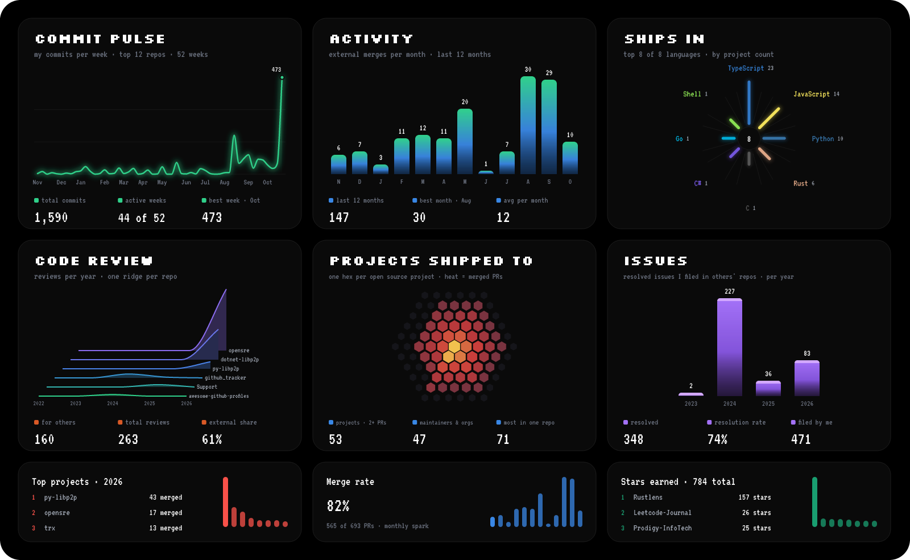
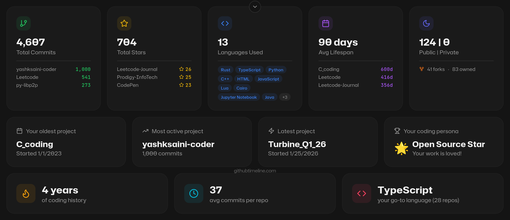

<!-- 

# 👨‍💻 Telling the machines what to do

### Hi there 👋, I'm **Open Source Developer**!

Building in public, share what I'm working on and learning. Currently learning about AI, ML, LLMs, RAG, System Design, DevOps, Web3, and more on low-level programming such as C, C++, and Rust.

Where I'm not working, I'm reading books and writing blogs, playing games is my thing, Grinding the burnout away.

##  | [Bounty 103$](https://x.com/yash_k_saini/status/1886322902573715709) | [Bounty 81$](https://x.com/0xCracked_dev/status/1951544807316201622) | [Bounty 7$](https://x.com/yash_k_saini/status/1883502087688073345) |

---

## 📝 What I've done
---

- Participated in ***[Kaggle](https://www.kaggle.com/yashsaini007)*** competitions (Competitions Contributor)
- Participated & won 5+ hackathons
- Built Python Packages during OSS events
- Writing blogs on **[Dev.to](https://dev.to/@yashksaini)** about my experiences and learnings

-->

 
<!--  -->

<!-- ## 📚 Latest Blog Posts -->

<!-- BLOG-POST-LIST:START -->
- [Dev log # 30 Plumbing the depths of libp2p: A multi-language maintenance week](https://dev.to/yashksaini/dev-log-30-plumbing-the-depths-of-libp2p-a-multi-language-maintenance-week-356b)
- [Dev log # 29 The Review Marathon: Hardening libp2p across C# and Python](https://dev.to/yashksaini/dev-log-the-review-marathon-hardening-libp2p-across-c-and-python-2f7i)
- [Dev Log # 28 A Quiet Week on the OSS Front](https://dev.to/yashksaini/attending-devcon-8-mumbai-a-quiet-week-on-the-oss-front-3kai)
- [What I learned building wfreq](https://dev.to/yashksaini/what-i-learned-building-wfreq-52f5)
- [Dev log #27 Deep in the review queue: Hardening libp2p across Python and .NET](https://dev.to/yashksaini/dev-log-deep-in-the-review-queue-hardening-libp2p-across-python-and-net-357l)
- [Dev log #26 Deep in the libp2p weeds: Fixing DHT prefixes and Yamux resets](https://dev.to/yashksaini/dev-log-26-deep-in-the-libp2p-weeds-fixing-dht-prefixes-and-yamux-resets-315n)
<!-- BLOG-POST-LIST:END -->

<!-- Youtube video sections -->

<!-- ### 📺 Latest YouTube Videos -->

<!-- BEGIN YOUTUBE-CARDS -->

<!-- END YOUTUBE-CARDS -->

<!-- 

 -->

<!-- Support Me Here -->

<!-- #  Sponsor me -->

 

<!-- 
 -->

<!--  -->

<!-- sponsors -->

<!-- 

  
  
  </a>

 -->

